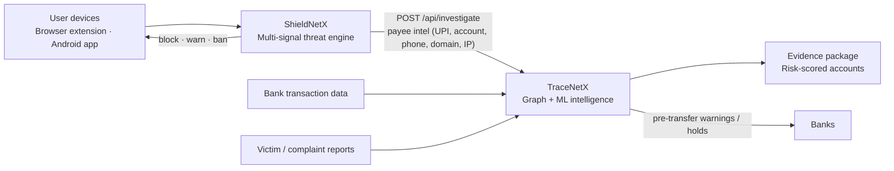

<div align="center">

# CyberNetX

### Detect. Trace. Neutralize.

**An end-to-end financial-fraud defense platform: stop scams before they reach the customer, and trace the money if they don't.**


</div>

---

## Overview

Online fraud is a two-sided problem. Victims get phished, and the stolen money disappears through layers of disposable mule accounts. Most tools cover only one side, and most are black boxes that block something without saying why.

**CyberNetX** closes both sides with two cooperating systems:

| Module | Role | What it does |
|---|---|---|
| **[ShieldNetX](./shieldnetx)** | Customer Shield | Real-time phishing and smishing detection that intercepts malicious links before they open |
| **[TraceNetX](./tracenetx)** | Bank Shield | AML mule-account detection and money-trail tracing using graph intelligence and an ML ensemble |

Threat intelligence flows from ShieldNetX into TraceNetX, so a scam blocked on one phone becomes a lead against the accounts behind it.

---

## Architecture



TraceNetX runs standalone and accepts three intake paths: bank-side behavioral detection, victim reports as seed nodes, and ShieldNetX payee intelligence. Flagged accounts can be pushed to banks, so people who never installed ShieldNetX are still protected.

---

## ShieldNetX: Customer Shield

Detects phishing in real time, on the device, before the user is exposed.

**Detection engine, six signals fused into one explainable risk score**

| Signal | What it looks at |
|---|---|
| Click Velocity | How fast and how widely a link is spreading |
| Dwell Time | How quickly people open a page and bail out, a strong tell for fake pages |
| Geo Velocity | Impossible or anomalous geographic travel of a link |
| HTML Analysis | Structure and content of the page source |
| JS Analysis | Obfuscation and malicious behavior in page scripts |
| Sender Trust | Reputation and context of the sender |

**Ghost Sandbox:** inspects live page behavior in a sandboxed browser and returns a verdict in under 3 seconds.

**Delivery surfaces**
- **Chrome extension** for in-browser protection
- **Android app** (Flutter) with a **Kotlin Accessibility Service** bridge that intercepts links system-wide, before any browser opens
- **FastAPI sentinel backend** for scoring and orchestration
- **Zero configuration** for the end user

**Automatic response on risky links:** block (warning screen with top reasons), warn (proceed-anyway option), ban (confirmed phishing domains, URLs and IPs go to a shared blocklist so repeats are stopped instantly), and report (payee details sent to TraceNetX).

Unlike copy-paste checkers that only know already-registered bad links, ShieldNetX analyzes behavior, so brand-new links don't slip through. It is built for everyone, not just bank customers.

---

## TraceNetX: Bank Shield

Most tools catch the criminal at the end of the chain. TraceNetX finds the **dealer**, the convergence point that mule accounts feed into. Mule accounts are disposable, but the dealer can't hide.

**Layer 1, DETECT.** Ensemble classification with XGBoost, LightGBM and Random Forest, with Isolation Forest as an independent anomaly signal. Class imbalance is handled with SMOTE, and every score is explained with **SHAP**.

**Layer 2, INVESTIGATE.** Neo4j graph intelligence:
- Forward traversal (**Spider Map**) and **reverse chain analysis**, tracing backward from the exit point to the coordinator
- Community detection, batch-recruitment detection (shared IP clusters), coordination and convergence analysis
- Pattern detectors for hawala-broker signatures, shell companies, crypto-gateway exposure and cross-border layering
- **City Map** geospatial view of fund movement
- Roles are derived from graph structure and behavior, never from account names

**Layer 3, ACT.** Graduated response instead of a binary flag:

| Level | Score | Response |
|---|---|---|
| CRITICAL | 85–100 | Immediate action |
| HIGH | 70–84 | Escalate |
| MEDIUM | 50–69 | Enhanced monitoring |
| LOW | 30–49 | Watchlist |
| CLEAR | 0–29 | No action |

- One-click **Evidence Package** with fund-flow chains, flagged-account details and a regulator-ready summary (STR / FIR style)
- CSV export of flagged accounts with risk scores and graph flags
- **Plug-and-play datasets:** upload any dataset and every view (Spider Map, City Map, Dashboard, Intelligence, Temporal, ML Analysis) rebuilds from it automatically

---

## Tech Stack

| Layer | Technologies |
|---|---|
| ML / Data | XGBoost, LightGBM, scikit-learn, TensorFlow/Keras, SHAP, imbalanced-learn, Pandas, NumPy |
| Graph | Neo4j, NetworkX |
| Backend | Python, FastAPI, Uvicorn |
| Frontend | React, Cytoscape.js |
| Mobile | Flutter, Kotlin (Accessibility Service) |
| Browser | Chrome Extension (Manifest V3) |
| Infra | Docker |

---

## Repository Structure

```
cybernetx/
├── shieldnetx/     # Phishing detection: extension, Android app, backend
├── tracenetx/      # Fraud graph platform: backend, frontend, docs
└── README.md
```

---

## Getting Started

### TraceNetX (local)

```bash
# 1. Graph database
docker run -d --name neo4j -p 7474:7474 -p 7687:7687 \
  -e NEO4J_AUTH=neo4j/<your-password> neo4j:latest

# 2. Backend (wait ~15s after Neo4j starts)
cd tracenetx/backend
python -m venv venv && source venv/bin/activate
pip install -r requirements.txt
uvicorn main:app --port 8001

# 3. Frontend
cd ../frontend/tracenetx-ui
npm install && npm start
```

### ShieldNetX

Each ShieldNetX component (extension, Android app, backend) has its own setup instructions in the [`shieldnetx/`](./shieldnetx) directory.


> Make sure the Neo4j credentials in your environment match the backend configuration. Never commit credentials to the repository.

---

## Roadmap

- [ ] APK-link analysis: static analysis, sandbox execution and GenAI code interpretation
- [ ] Visual brand-impersonation detection (CLIP-based) and page fingerprinting (logo hash, DOM/phishing-kit hash, favicon hash, TLS server fingerprint)
- [ ] URL and domain intelligence: domain age, fresh certificates, typosquatting and punycode, redirect depth, ASN/TLD reputation
- [ ] LSTM lifecycle modeling, and victim-vs-criminal account classification
- [ ] Kafka streaming for real-time ingestion
- [ ] Regulator feed integration (I4C, NCRP, FIU-IND)
- [ ] Hardware: ESP32 desk appliance and router plug for network-wide protection

---

## Team

Built by **Team OMEGA 404**, Sri Sairam Engineering College, Chennai, in association with **OWASP Sri Sairam**.

**Lead:** [Shravan Khanal](https://github.com/learnfast12)

---

<div align="center">

**CyberNetX: Detect. Trace. Neutralize.**

</div>
